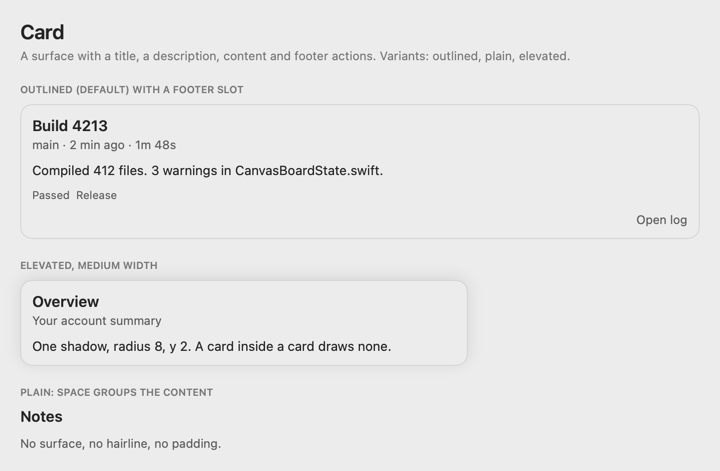
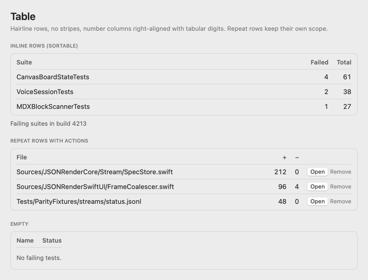
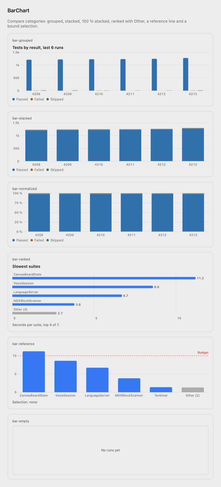
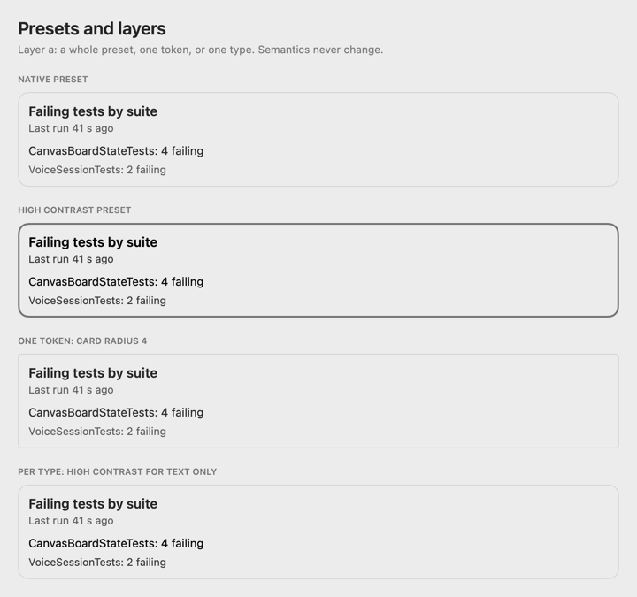

# swift-json-render

A native Swift runtime for the [json-render](https://github.com/vercel-labs/json-render) specification: a model streams a small JSON tree, and SwiftUI draws it as native views. Spectacularly simple by default, highly customisable in layers.

Status: pre-release, `0.22.0-alpha.2`. It implements json-render 0.22.0 (commit `1819412`). Pin an exact alpha tag until `0.22.0` is released.

## What it is

- **The json-render spec, unchanged.** A flat JSON document: a root id, elements by id, and state. Upstream prompts, skills and fixtures carry over.
- **Native SwiftUI.** 36 standard components and 15 charts on Swift Charts, with system colours, light and dark, Increase Contrast, VoiceOver and keyboard support.
- **No web view and no code evaluation.** A spec is data. Every effect goes through a name that your app registered.

## Quick start

```swift
import JSONRender
import SwiftUI

let json = """
{"root": "card", "elements": {
  "card": {"type": "Card", "props": {"title": "Hello"}, "children": ["text"]},
  "text": {"type": "Text", "props": {"text": "A native card from JSON."}, "children": []}}}
"""

struct HelloView: View {
    var body: some View {
        if let spec = try? Spec.decode(Data(json.utf8)).spec, let catalog = try? Catalog.standard {
            JSONRenderView(spec: spec, catalog: catalog)
        }
    }
}
```

To draw a spec while a model writes it, swap the view for `JSONRenderStreamView(stream: chunks, mode: .jsonl, catalog: catalog)`, where `chunks` is an `AsyncThrowingStream<String, any Error>`. Skeletons fill in as the patches arrive.

## Install

```swift
// Package.swift
.package(url: "https://github.com/vatsalsaglani/swift-json-render.git", exact: "0.22.0-alpha.2"),
```

Then add the products you use to your target:

| Product | What it holds | Platforms |
|---|---|---|
| `JSONRender` | One import: the core, the SwiftUI renderer and the standard catalog. Start here | macOS 14, iOS 17 |
| `JSONRenderCore` | Spec model, expressions, state, actions, validator, catalog, prompt, stream decoder. Foundation only | macOS, iOS, Linux |
| `JSONRenderSwiftUI` | `JSONRenderView`, `JSONRenderStreamView`, themes, style hooks | macOS 14, iOS 17 |
| `JSONRenderStandardCatalog` | `Catalog.standard`: the 36 components, directives, built-in actions | macOS 14, iOS 17 |
| `JSONRenderCharts` | `Catalog.charts`: the 15 charts | macOS 14, iOS 17 |
| `JSONRenderClient` | `@JRComponent` for your own components | macOS, iOS, Linux |
| `JSONRenderCompose` | Optional batched composer on the OpenAI Decisions API | macOS, iOS, Linux |
| `JSONRenderRemoteImages` | Reserved for a ready-made `https` image provider; empty in this release | macOS 14, iOS 17 |

The package needs Swift 6.2 tools. Charts, the composer and remote images stay separate on purpose, so an app pays only for what it imports.

## Skills for coding agents

```sh
npx skills add vatsalsaglani/swift-json-render --skill json-render-swift-use
npx skills add vatsalsaglani/swift-json-render --skill json-render-swift-update
```

`json-render-swift-use` teaches an agent to write specs for the catalogs and to wire the package into an app. `json-render-swift-update` teaches it to extend the package: components, charts, tokens, tests and releases. (The install lines work once the repository is public.)

## Screenshots

These are the real SwiftUI views, rendered by the Gallery with the native preset (light or dark, following your GitHub theme).

<picture>
  <source media="(prefers-color-scheme: dark)" srcset="docs/images/card-dark.png">
  
</picture>
<picture>
  <source media="(prefers-color-scheme: dark)" srcset="docs/images/table-dark.png">
  
</picture>
<picture>
  <source media="(prefers-color-scheme: dark)" srcset="docs/images/barchart-dark.png">
  
</picture>
<picture>
  <source media="(prefers-color-scheme: dark)" srcset="docs/images/theme-presets-dark.png">
  
</picture>

## Customisation

Six layers, from least to most effort. Customisation never changes what a spec means: the same spec gives the same state changes and the same actions with any of them.

1. **Theme tokens.** Colour roles, type, spacing, radius, elevation, motion and chart tokens. `.native` and `.highContrast` ship; `validated()` checks contrast.
2. **Variants.** Looks the catalog declares and the spec picks, such as `variant: "elevated"`.
3. **Style hooks.** A SwiftUI style protocol per component, shaped like `ButtonStyle` (`JRCardStyle`, `JRTableStyle`, `ChartStyle`).
4. **Slots.** Named child regions: `header`, `footer`, `empty`, `loading`, `error`.
5. **View replacement.** `catalog.override("Table") { … }` swaps one view and keeps its props and actions.
6. **Custom components.** `@JRComponent` for new types, plus registered actions, functions, directives and rules.

## Charts

`BarChart`, `LineChart`, `AreaChart`, `PieChart`, `Gauge`, `Sparkline`, `ScatterChart`, `Heatmap`, `Histogram`, `ComboChart`, `Waterfall`, `Funnel`, `BoxPlot`, `Candlestick` and `Treemap`. Each has a few props, budgets that keep it readable, a VoiceOver summary and a "Show as Table" view.

## Parity

The runtime is tested against json-render's own cases at a pinned commit, `18194121c8f087afacd9a8ef65fbda18374ee039` (release v0.22.0). The result of the last run, case counts per folder, and what the package adds on purpose are in [`docs/parity.md`](docs/parity.md).

## Platforms

macOS 14 and iOS 17 for the renderer, the standard catalog and the charts. `JSONRenderCore`, `JSONRenderClient` and `JSONRenderCompose` also build on Linux, so a server can decode, validate, repair and prompt.

## Gallery

A small app with a page for every component and chart, the theme layers, accessibility checks and a streaming replay.

```sh
swift run --package-path Examples/Gallery Gallery
swift run --package-path Examples/Gallery Gallery --snapshot ./snapshots   # headless PNGs
```

## Documentation

The DocC catalog has ten articles (getting started, the spec, expressions, streaming, nesting, theming, charts, parity, security, compose).

```sh
swift package --allow-writing-to-directory ./docs-out generate-documentation \
  --target JSONRenderCore --output-path ./docs-out
```

See [CHANGELOG.md](CHANGELOG.md) for changes and [CONTRIBUTING.md](CONTRIBUTING.md) to work on the package.

## Licence and credits

Apache-2.0. See `LICENSE` and `NOTICE`. The spec, the prompt text and the parity fixtures come from [vercel-labs/json-render](https://github.com/vercel-labs/json-render) (Apache-2.0). Some design ideas (the component macro, the JSON value and pointer types) are adapted, with credit, from [rxtech-lab/json-render-swift](https://github.com/rxtech-lab/json-render-swift) (MIT).
